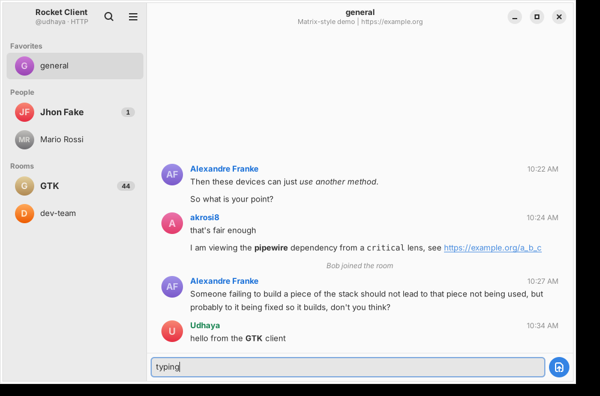
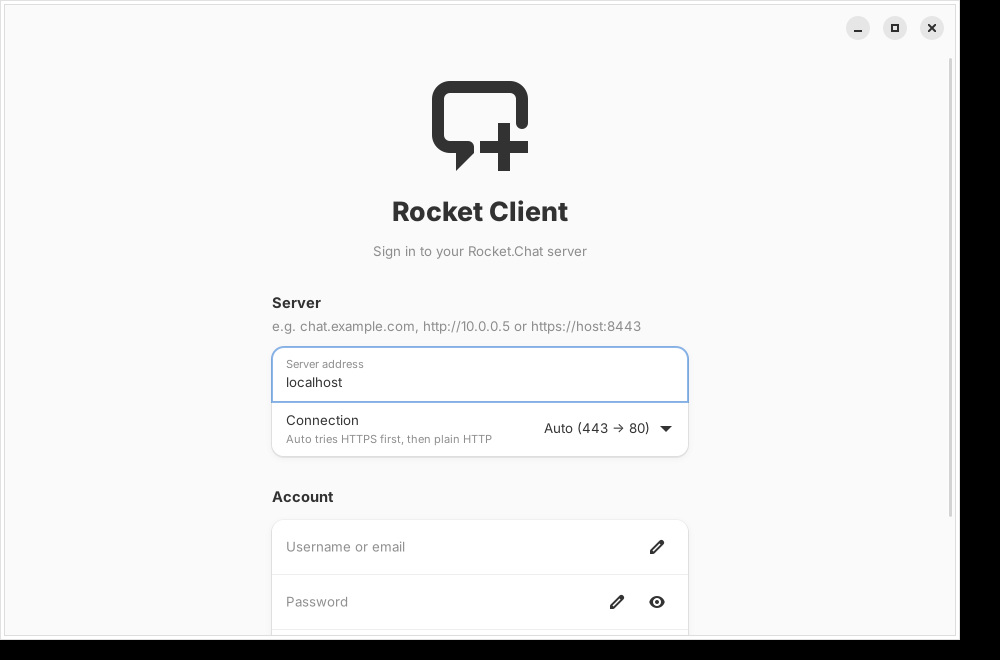
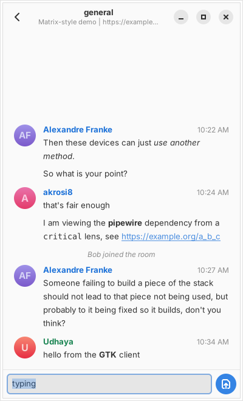

# Rocket Client

A minimal [Rocket.Chat](https://rocket.chat) messaging client for the GNOME desktop,
written in **C** with **GTK 4**, **libadwaita**, **libsoup 3** and **json-glib**.



## Features

- Sign in with username/email + password (optional 2FA/TOTP code)
- **Port 443 and port 80**:
  - **Auto (443 → 80)** – tries `https://` (443) first, falls back to `http://` (80)
  - **HTTPS (443)** – TLS only (`https://`, realtime over `wss://`)
  - **HTTP (80)** – plain HTTP (`http://`, realtime over `ws://`); shows a warning
  - Explicit URLs such as `http://10.0.0.5`, `https://host:8443/rocket` are honoured as typed
- Sidebar with **Favorites / People / Rooms**, unread badges, room search
- Message view grouped by sender, avatars, `*bold*`, `_italic_`, `~strike~`, `` `code` ``, clickable links
- **Realtime** messages via the Rocket.Chat DDP WebSocket API (auto-reconnect)
- Desktop notifications for direct messages and @mentions
- Adaptive layout (works down to phone width), session remembered between runs

<p>
 
</p>

## Build on Debian forky

```bash
sudo apt install build-essential meson ninja-build pkgconf libgtk-4-dev libadwaita-1-dev libsoup-3.0-dev libjson-glib-dev glib-networking
```

```bash
meson setup build
```

```bash
meson compile -C build
```

```bash
./build/rocket-client
```

Run the unit tests:

```bash
meson test -C build
```

Install system-wide (adds the desktop entry and icon):

```bash
sudo meson install -C build
```

### Build a .deb package

```bash
sudo apt install debhelper devscripts
```

```bash
dpkg-buildpackage -us -uc -b
```

```bash
sudo apt install ../rocket-client_0.1.0_amd64.deb
```

GitHub Actions builds the binary and `.deb` in a `debian:forky` container on every push
(see the *Actions* tab → *rocket-client-debian-forky* artifact).

## Rocket.Chat APIs used

| Purpose | Endpoint |
|---|---|
| Login | `POST /api/v1/login` |
| Session check | `GET /api/v1/me` |
| Room list | `GET /api/v1/subscriptions.get` |
| History | `GET /api/v1/{channels,groups,im}.history` |
| Room topic | `GET /api/v1/rooms.info` |
| Send | `POST /api/v1/chat.sendMessage` |
| Mark read | `POST /api/v1/subscriptions.read` |
| Avatars | `GET /avatar/{username}` |
| Realtime | `ws(s)://server/websocket` – DDP `stream-room-messages`, `stream-notify-user` |

## Notes

- The session token is stored in `~/.config/rocket-client/session.ini` with mode `0600`.
  *Log Out* revokes it on the server and deletes it locally.
- HTTPS needs the `glib-networking` package (TLS backend for libsoup).
- System proxy settings are respected.

## Layout

```
src/main.c        application, CSS, actions
src/rc-client.c   REST + DDP WebSocket client, 443/80 handling
src/rc-window.c   UI: login page, sidebar, message view, composer
tests/            unit tests for URL/port handling
debian/           Debian packaging
```

## License

MIT
