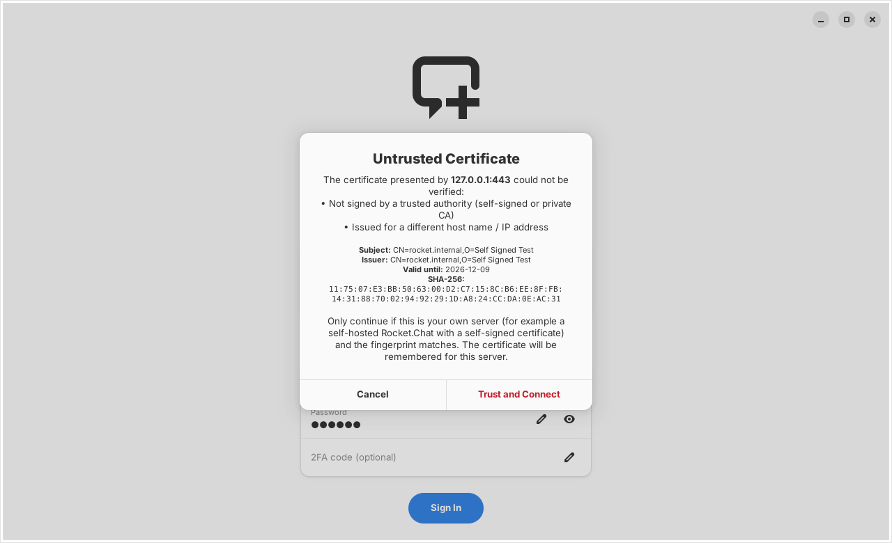
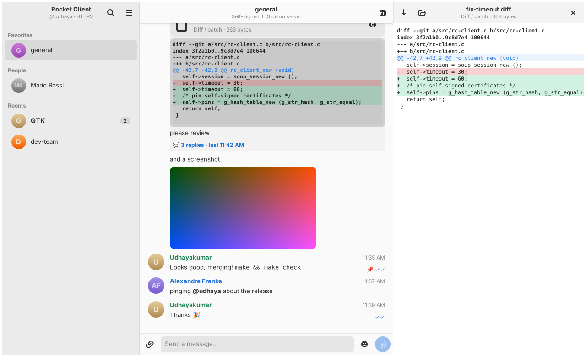
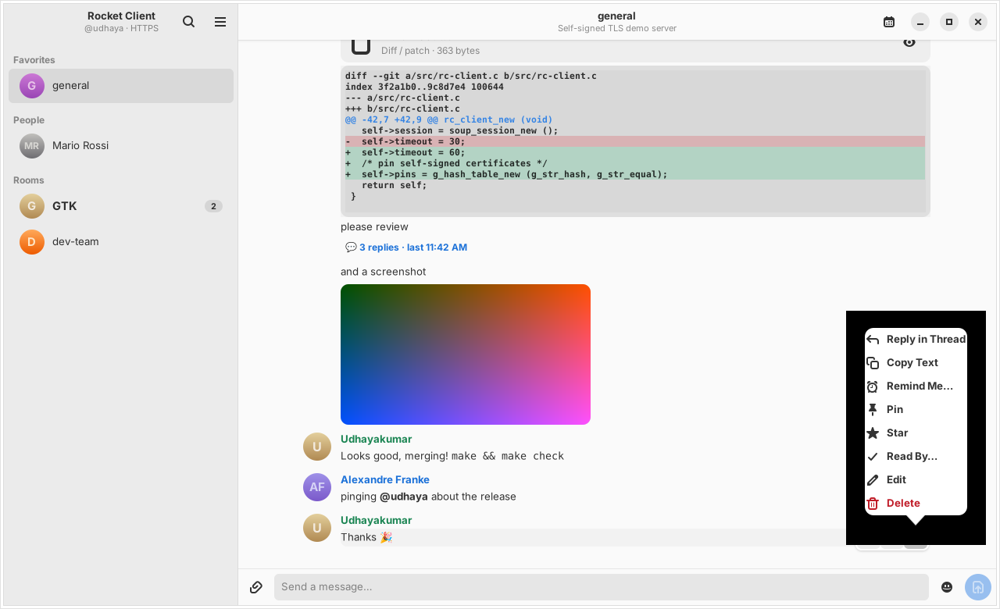
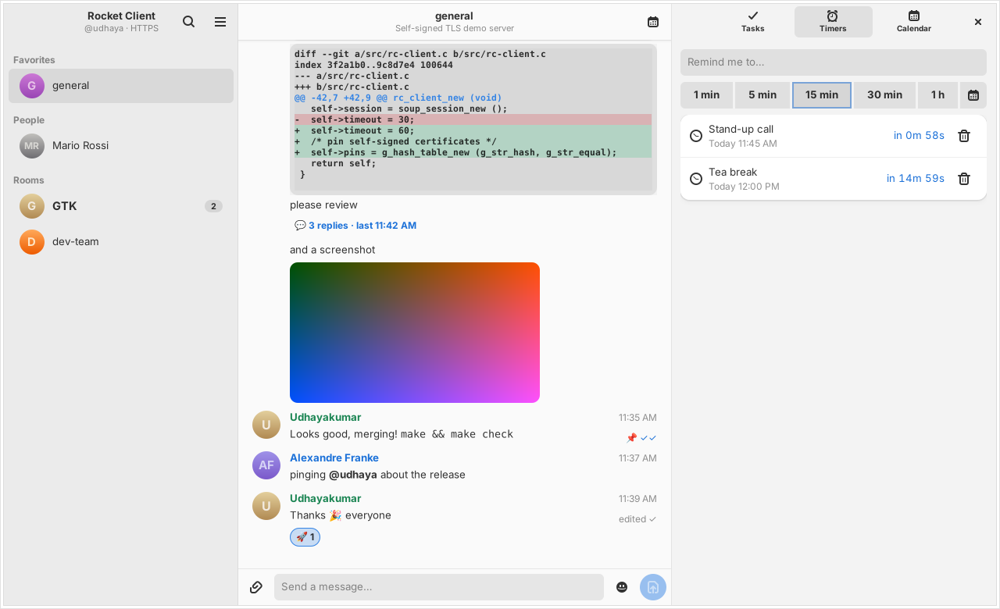
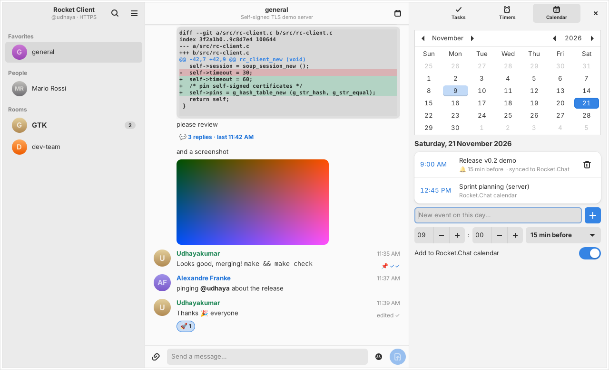

# Rocket Client

A lightweight [Rocket.Chat](https://rocket.chat) messaging client for the GNOME desktop,
written in **C** with **GTK 4**, **libadwaita**, **libsoup 3** and **json-glib**.


## Features

**Connection**
- **Port 443 and port 80**: *Auto (443 → 80)*, *HTTPS (443)* (`https://` + `wss://`), *HTTP (80)* (`http://` + `ws://`, with a warning).
  An address typed with a scheme (`https://10.2.0.251`, `http://host:3000`) is used as typed.
- **Self-signed / private-CA servers**: like a browser, the app shows the certificate (subject, issuer,
  expiry, SHA-256 fingerprint, what's wrong with it) and lets you **Trust and Connect**. The fingerprint is
  pinned per `host:port` in `~/.config/rocket-client/trusted-certs.ini`; if the certificate changes you are asked again.

**Messaging**
- Rooms sidebar (Favorites / People / Rooms), unread badges, search
- Realtime messages, edits, deletes over the Rocket.Chat DDP WebSocket; typing indicator ("alex is typing…")
- `*bold*` `_italic_` `~strike~` `` `code` `` ```` ```blocks``` ````, links, **@mentions**, `:shortcode:` → emoji
- **Emoji picker** in the composer, **reactions** (click to toggle, hover to see who)
- **Threads** in a side column (reply, live reply counter)
- **Edit** (or ↑ in an empty composer), **Delete**, **Pin**, **Star**, **Copy**, load older messages
- **Read receipts**: ✓ sent, ✓✓ read (updates live) and **Read By…** with the time each person read it
  (needs read receipts enabled on the server)
- Desktop notifications for DMs and @mentions (click opens the room); optional **run in background**

**Files**
- Upload with the 📎 button, **Ctrl+U** or **drag & drop**, with an optional caption
  (`rooms.media` + `rooms.mediaConfirm`, falls back to `rooms.upload` on older servers)
- Images inline; **type detection** by MIME/extension/content sniffing
- **Text & diff files are previewed right in the chat** (first lines, with +/− colouring) and open
  in a **side column** viewer (full diff/text, image viewer, audio/video player) with *Save As…* and *Open With…*

**Planner** (calendar button in the header)
- **Tasks** with due date/time and reminders
- **Timers & reminders**: 1/5/15/30/60-minute timers or any date/time, live countdown,
  **"Remind me about this message"** from the message menu (with a jump-back button)
- **Calendar** with your events (reminder 0–1440 min before); shows and creates events in the
  **Rocket.Chat calendar** (`calendar-events.*`) when the server supports it
- Stored in `~/.local/share/rocket-client/planner.json`; reminders that came due while the app was closed are delivered on next start

<p>
 
 
 
</p>

## Build on Debian forky

```bash
sudo apt install build-essential meson ninja-build pkgconf libgtk-4-dev libadwaita-1-dev libsoup-3.0-dev libjson-glib-dev glib-networking gstreamer1.0-plugins-good
```

```bash
meson setup build
```

```bash
meson compile -C build
```

```bash
./build/rocket-client
```

Run the unit tests:

```bash
meson test -C build
```

Install system-wide (adds the desktop entry and icon):

```bash
sudo meson install -C build
```

### Build a .deb package

```bash
sudo apt install debhelper devscripts
```

```bash
dpkg-buildpackage -us -uc -b
```

```bash
sudo apt install ../rocket-client_0.2.0_amd64.deb
```

GitHub Actions builds the binary and `.deb` in a `debian:forky` container on every push
(see the *Actions* tab → *rocket-client-debian-forky* artifact).

## Rocket.Chat APIs used

| Purpose | Endpoint |
|---|---|
| Login / session | `POST /api/v1/login`, `GET /api/v1/me`, `POST /api/v1/logout` |
| Rooms | `GET /api/v1/subscriptions.get`, `GET /api/v1/rooms.info`, `POST /api/v1/subscriptions.read` |
| History | `GET /api/v1/{channels,groups,im}.history` (with `latest` for older pages) |
| Messages | `chat.sendMessage`, `chat.update`, `chat.delete`, `chat.react`, `chat.pinMessage`/`unPinMessage`, `chat.starMessage`/`unStarMessage` |
| Threads | `GET chat.getMessage`, `GET chat.getThreadMessages`, `sendMessage` with `tmid` |
| Read receipts | `GET chat.getMessageReadReceipts`, message `unread` flag |
| Files | `POST rooms.media/{rid}` + `rooms.mediaConfirm/{rid}/{fileId}` (fallback `rooms.upload/{rid}`), `GET /file-upload/…` |
| Calendar | `GET calendar-events.list`, `POST calendar-events.create` / `.delete` |
| Avatars | `GET /avatar/{username}`, `/avatar/room/{rid}` |
| Realtime | `ws(s)://server/websocket` – DDP `stream-room-messages`, `stream-notify-user`, `stream-notify-room` (`deleteMessage`, `user-activity`, `typing`, `messagesRead`) |

### Not implemented (yet)
Video/voice calls, end-to-end encrypted rooms, discussions, omnichannel/livechat, Apps-Engine UI
(UIKit modals), slash commands, message search, user presence status and admin features.

## Notes

- The session token is stored in `~/.config/rocket-client/session.ini` with mode `0600`
  (not in the system keyring).
  *Log Out* revokes it on the server and deletes it locally.
- HTTPS needs the `glib-networking` package (TLS backend for libsoup). Video/audio preview uses
  GTK's GStreamer media backend (`gstreamer1.0-plugins-good`, installed with GNOME).
- With *Run in Background* on (default), closing the window keeps the app running so messages
  and reminders still arrive; use **Quit** (Ctrl+Q) to exit. Reminders only fire while the app runs.
- Keyboard: Ctrl+U attach, ↑ edit last message, Esc cancel edit, F5/Ctrl+R refresh, Ctrl+Q quit.
- System proxy settings are respected.

## Layout

```
src/main.c        application, CSS, actions
src/rc-client.c   REST + DDP WebSocket client, 443/80 handling, uploads, certificate pinning
src/rc-window.c   UI: login, sidebar, messages, threads, reactions, uploads, side column
src/rc-preview.c  file type detection + preview column (diff/text/image/media)
src/rc-planner.c  tasks, timers/reminders, calendar
src/rc-emoji.c    emoji shortcodes + reaction picker
tests/            unit tests for URL/port handling
debian/           Debian packaging
```

## License

MIT
